# Original development goals and next step

Updated October 20, 2026. The original proposal under `outputs/` remains unchanged. This status document tracks implementation against its acceptance gates.

The user has deferred public MCP hosting, Claude setup and official plugin publication. Continue the independent screen reader and evidence-backed workflow.

| Original milestone | Status | Delivered | Remaining gate |
| --- | --- | --- | --- |
| 0: core assumptions | Partial | Real Chromium semantics, separate cursor/focus, bounded keyboard input, same-context capture exclusion and controlled video canaries | Complete command/persistence exclusion, Xvfb takeover and authenticated remote handshake |
| 1: local screen reader | Substantial local implementation | Reader profile v13, fixtures, bounded events/observations, policy checks and CI | Capture/privacy feasibility remains a prerequisite to editable entry and recording; broader supported-control scope is explicit |
| 2: evidence-backed workflow | In progress | Bounded routes, immutable JSON, node/edge reports, controlled recording canaries and 20-marker synchronization proof | Attach permitted route recordings and frame/event links; diagnostic feature provenance, local evidence viewing and separate eligible replay results |
| 3: intervention and isolation | Partial | Exact public-host policy and independent Linux egress fence | Capture exclusion, headed Xvfb/private viewer and exclusive input ownership with expiring controller leases |
| 4: durable hosted execution | Planned | Local append-only receipts are a starting contract | Supabase authorization, durable attempt storage, pgmq idempotency/fencing, private S3 finalization and failure/recovery tests |
| 5: hosted pilot | Deferred | Existing local stdio adapter | Public HTTPS endpoint, remote authorization, operations, client acceptance and hosted report |
| 6: measured extensions | Later | Bounded reader improvements through v13 | Broader validated widgets and compatible-run comparisons; public plugins remain deferred |

## Next: linked recording evidence for traversal

The [capture admission protocol](decisions/0019-capture-admission.md) fences observations and both keyboard paths, drains actual operations after caller cancellation, requires AX stop acknowledgement, preserves the same context, and resets the reader baseline across epochs. Failed or stalled transitions remain closed. The [controlled collector probe](decisions/0020-capture-collector-feasibility.md) adds separately opted-in synthetic recording segments with pending-write drain, decoded video/JPEG canaries, staging inspection, artifact hashes and explicit failure stages. Default sessions start no recording collector.

The [20-marker synchronization probe](decisions/0021-recording-synchronization.md) now uses raw Chromium JSON timestamps, independent visual frame identities and clock calibration. All twenty actual reader actions passed the unchanged 250 ms conservative target locally. The SDK single-precision timestamp is bypassed. Run `dotnet run --project src/HeadlessScreenReader.Cli -c Release -- --recording-sync` to inspect its original video, event timeline, hashes and measured errors. Platform/CI evidence is tracked separately in [validation](validation/recording-synchronization-v1.md).

**[NEXT: attach recordings and passive frame/event links to the authored traversal reports](decisions/0021-recording-synchronization.md#next-recording-evidence-for-traversal).** Start with a trusted shop fixture whose permitted visual content excludes prefilled private values. General recordings, complete reader-command/persistence exclusion, credential entry, a human takeover lease and a private viewer remain separate work. The privacy probe remains available with `--capture-probe`.

```mermaid
flowchart LR
    Reader[Reader v13] --> Trace[Authored node/edge traces]
    Trace --> Privacy[Controlled capture exclusion]
    Privacy --> Timing[20-marker synchronization]
    Timing --> Next[NEXT: route recordings and frame links]
    Next --> Control[Exclusive input and private viewer]
    Control --> Durable[Durable hosted execution]
    classDef done fill:#dcfce7,stroke:#166534,color:#14532d
    classDef next fill:#dbeafe,stroke:#1d4ed8,color:#1e3a8a
    classDef planned fill:#f3f4f6,stroke:#6b7280,color:#374151
    class Reader,Trace,Privacy,Timing done
    class Next next
    class Control,Durable planned
    click Next "decisions/0021-recording-synchronization.md#next-recording-evidence-for-traversal"
```



Green means an implemented, locally validated bounded capability; blue is the next increment; gray is planned. These are not full milestone-completion labels. CI, deployment and assistive-technology gates remain separate.

## Run the completed traversal slice

```powershell
dotnet run --project src/HeadlessScreenReader.Cli -c Release --no-build -- --traversal
```

Open the index path printed in the JSON summary. Four routes run in fresh browsers and produce separate receipts. Earlier batches are preserved. The report is passive evidence; selecting a link never sends browser input.

This is authored route execution rather than an autonomous frontier search. Graph version `execution-trace-v2` has one node per retained observation, labeled reader-command/browser-key edges and separate unresolved attempts. SVG files show the directed trace and link to the equivalent observation/event evidence; states are not merged. No video, annotation, takeover or hosted durability is claimed.

## Later: features and reasonable action paths

The [feature-path concept](decisions/0018-feature-path-traces.md) ties future objectives to candidate command/keystroke paths. Preserve the successful and unsuccessful traces needed to assess discoverability, repetitions, backtracking, timing and interaction burden. A bounded search that finds no combination remains Unknown; a large or complex graph alone does not establish unreasonable effort. Feature search and the burden rubric remain future work, and do not displace the capture exclusion gate.
