# Original development goals and next step

Updated October 25, 2026. The original proposal under `outputs/` remains unchanged. This status document tracks implementation against its acceptance gates.

Prioritize an independently usable core API and MCP. The Lovable UI consumes this service through Edge Functions in existing Supabase project `gpnijaxrgtwzwtrqsbcu`. Public MCP hosting and official plugin publication remain separate from implementing the core protocols.

| Original milestone | Status | Delivered | Remaining gate |
| --- | --- | --- | --- |
| 0: core assumptions | Partial | Real Chromium semantics, separate cursor/focus, bounded keyboard input, same-context browser/reader exclusion, owned local persistence, headed Xvfb continuity, controlled video canaries and combined synthetic excluded-input handoff and scoped loopback semantic and pixel viewing | Authenticated remote provider and handshake; human/AT viewing acceptance |
| 1: local screen reader | Substantial local implementation | Reader profile v13, fixtures, bounded events/observations, policy checks and CI | Capture/privacy feasibility remains a prerequisite to editable entry and recording; broader supported-control scope is explicit |
| 2: evidence-backed workflow | In progress | Bounded routes, append-only JSON, node/edge reports, controlled recording canaries, 20-marker timing proof and original route media with capture/action/event intervals and passive local viewer; bounded diagnostic provenance, explicit fresh-run replay and owned evidence writes | Broader workflow acceptance and diagnostics/search coverage |
| 3: intervention and isolation | Partial | Exact public-host policy, independent Linux egress fence and exclusive local controller leases, headed Xvfb continuity and explicitly simulated excluded input and scoped loopback semantic and pixel viewing | Actual human/AT acceptance and hosted identity/capture/persistence fencing |
| 4: durable hosted execution | In progress | Admission/fenced leases and196 PostgreSQL/pgmq cases; signed-in one-shot/S3; ten private MCP tools; real application-user isolated reader JWT/RLS, navigation, graph evidence and native close accepted at1a5c6dc | Broader tenant restart/recovery; authenticated Edge-to-core; real revoked/expired reader authority acceptance |
| 5: public MCP pilot | Deferred | Local stdio and private HTTP-backed read-only stdio adapter | Public MCP HTTPS endpoint, client onboarding, plugin and pilot operations; private report remains active milestone4 work |
| 6: measured extensions | Later | Bounded reader improvements through v13 | Broader validated widgets and compatible-run comparisons; public plugins remain deferred |

<a id="next-isolated-hosted-reader-sessions"></a>

## Next: authenticated Edge-to-core connection

**Signed-in reader accepted:** [the real application-user check](validation/private-tenant-reader-v1.md)
passed at1a5c6dc: original-user provider authentication/RLS, two observations,
heading/button navigation, matching paged events/state-edge trace, anonymous
and foreign-workspace denial, API close and independent normal native removal.
`AppJwtValidated=true` and `HostedTenantReaderAccepted=true` apply to that
specific deployed HTTP workflow; actual revoked/expired membership and human/AT
acceptance remain separate. No browser input or goal verification was introduced.

**Do next:** [connect the existing Supabase Edge Functions to core](next-edge-to-core-connection.md).
The UI remains a third-party consumer. Its hosted Edge Functions cannot reach
the local SSH tunnel; a reachable authenticated path/hostname is needed. Keep
the core private until that choice is made. Public MCP/plugins stay deferred.

**Current increment:** [private MCP durable scans](decisions/0052-private-mcp-durable-scans.md)
adds fixed-fixture job admission, recent history and saved reports to the existing
private consumer. Caller request IDs preserve idempotent retries. Reports retain
execution/evidence states and storage provenance, with fresh authority and
response-fenced byte paging across reconnect. The worker remains responsible
for durable execution; client disconnect does not cancel it. There are ten
hosted tools. [Validation](validation/private-mcp-scans-v1.md) separates actual
stdio/Chromium saved-byte tests from provider identity and hosted acceptance.

**Accepted private reader/MCP baseline:**1a5c6dc passed all nine jobs in
[CI40229319948](https://github.com/jvelezc/ai-screen-reader/actions/runs/40229319948),
Windows/Ubuntu2,004 each, native Linux30 and operator122. Exact private backend
[deployment40230505705](https://github.com/jvelezc/ai-screen-reader/actions/runs/40230505705)
and four independent VPS checks passed. The consumer runs in the client's
process; backend delivery, synthetic stdio tests and the real HTTP account
acceptance above retain separate evidence.

**Accepted ownership repair:** d7d63d5 passed all nine jobs in
[CI40134920784](https://github.com/jvelezc/ai-screen-reader/actions/runs/40134920784),
Windows/Ubuntu1,886 each, and exact private
[deployment40135905906](https://github.com/jvelezc/ai-screen-reader/actions/runs/40135905906).
Independent VPS checks confirmed the isolated reader baseline; provider identity
and human acceptance remain separate. [Text cursor ownership](decisions/0050-text-cursor-ownership.md)
invalidates retained offsets when the same node moves to another frame/document.
Unknown state persists until explicit re-anchoring; unchanged owners retain their
position. Hosted trace preserves the reset instead of presenting stale text as
current evidence. See [ownership validation](validation/text-cursor-ownership-v1.md).

**Accepted state/edge baseline:** source25b2ecb passed all nine jobs in
[CI40080149650](https://github.com/jvelezc/ai-screen-reader/actions/runs/40080149650):
Windows/Ubuntu1,872 each, native Linux30, operator122. Exact private
[deployment40081051473](https://github.com/jvelezc/ai-screen-reader/actions/runs/40081051473)
and independent VPS checks confirm contract1.3.0, paged snapshot/state/edge
evidence, scoped native cleanup/recovery and unchanged public ingress.
AppJwtValidated=false and HostedTenantReaderAccepted=false remain explicit.

**Accepted navigation baseline:** source4468405 passed all nine CI jobs39992719717,
Windows/Ubuntu1,847 each, native Linux30, operator122 and exact private
deployment39995270368. Independent VPS service/broker/native checks confirmed
document-fenced navigation and paged history with synthetic identities.

**Next acceptance action:** complete [authenticated Edge-to-core connectivity](next-edge-to-core-connection.md)
through the existing Supabase project. The original-user HTTP reader acceptance
has passed; synthetic MCP/native checks do not become real identity-provider
MCP execution or human/AT acceptance. The [isolated-reader delivery sequence](next-isolated-reader-sessions.md)
remains as historical context. Original-user membership revocation/expiry,
broader hosted recovery and public publication retain distinct gates.

**Persistent child accepted:** source `5d87312` passed all nine jobs in
[CI 39875200017](https://github.com/jvelezc/ai-screen-reader/actions/runs/39875200017),
with Windows and Ubuntu each 1,702/1,702, and exact private deployment
39876744008. The [timing-test repair](validation/persistent-reader-worker-v1.md)
preserved the original native deadlines.

**Second delivery step implemented:** the container supervisor now reserves
launch ownership, uses an exclusively locked separate reader journal, reuses
the immutable-image isolation checks and confirms native removal independently
of child shutdown. Parent expiry/cancellation, bounded persistent IPC and retry
after uncertain removal have 35 passing focused Windows cases. Full local Windows passes 1,737/1,737, zero failures/skips,
the nonincremental Release build has zero warnings/errors, and format verification
passes. The Windows-launched Linux/Podman harness passes25/25, including actual
packaged readers, capacity/reuse, native removal and separate recovery.
The first supervisor release passed all nine CI jobs, but an extra VPS canary
found Podman4.9 entrypoint serialization differs from Docker. Its exact-shape
repair is locally validated; replacement CI and VPS reader acceptance are
tracked separately in the validation record.
See [the ownership decision](decisions/0046-isolated-reader-supervision.md) and
[current validation](validation/isolated-reader-supervisor-v1.md).

**Native runtime accepted:** `2bc8405` passed all nine jobs in CI39909237769,
exact private deployment39910679532 and a fresh actual VPS Podman4.9 reader canary.
The original four-second exit and five-second ownership deadlines remain intact.

**Isolated API delivery accepted:** source3471fd3 passed CI39924056549 and exact
private deployment39925519783; signed-in reader acceptance remains open. The implementation
connects the registry to the trusted worker through a private loopback broker;
the HTTP service keeps its existing read-only filesystem. Packaged Chromium proof
passes28/28 and Linux operator checks122/122. These synthetic identities do not
establish application JWT acceptance. See [the exact requirements and gates](validation/isolated-reader-http-v1.md).

<a id="next-signed-in-hosted-fixture-and-s3-acceptance"></a>

**Just accepted:** a real signed-in application user admitted a tenant shop run;
the isolated worker completed it in one attempt, retired its lease, and returned
32 exposed nodes. The downloaded report's S3 digest matched independent VPS
readback of the original 31,510-byte private object; anonymous access returned
403. Zero browser inputs and no verified goal remain explicit. See
[the exact evidence and limits](validation/supabase-s3-provider-v1.md).

### Core API and MCP contract parity

[Core HTTP contract 1.0.0](decisions/0043-core-http-contract.md) now describes the
existing authenticated workspace, fixed-fixture admission and evidence-report API
with DTO-derived response schemas, explicit errors/headers and report consistency
constraints. That workspace/report surface is deployed and accepted for the
fixed fixture; it is not a complete interactive-reader HTTP surface. The existing local stdio MCP implementation stays
in the core repository.

[Tenant-owned reader sessions](decisions/0044-tenant-reader-sessions.md) now add
core HTTP open/read/observe/close operations with subject and current workspace
authorization, monotonic expiry, capacity limits, actual cancellation drain and
quarantined cleanup failures. Contract1.2.0 adds read-only navigation and paged command history;
contract1.3.0 adds actual state/edge trace pages with capture evidence and explicit truncation.
Only the bundled Foundation fixture is admitted; no browser input or recording is
enabled. A real Chromium/Kestrel consumer test exercises the lifecycle.

**Navigation implementation:** [decision0048](decisions/0048-hosted-read-only-navigation.md)
adds an explicit browse-command allowlist, prior-observation/document fences,
fresh isolated captures and bounded, explicitly truncated history. No keyboard
input or activation is admitted. Define gateway
authentication/tenant delegation and an approved
Edge-to-core network path before wiring Supabase Edge Functions or expanding the
Lovable screens. The UI is a third-party consumer even though we own both repos.

Core source `a56c7c7` passed all nine jobs in
[CI 39865437194](https://github.com/jvelezc/ai-screen-reader/actions/runs/39865437194),
including Windows and Linux 1,607/1,607 each. Local Windows also passed
1,607/1,607 and full format verification. Private promotion in
[deployment 39867164095](https://github.com/jvelezc/ai-screen-reader/actions/runs/39867164095)
and independent listener readback identify
that same release and contract 1.1.0. Both trusted services have S3 configuration;
actual app-user JWT and hosted fixed-fixture execution are now accepted; human/AT acceptance remains open.
The same tenant report was downloaded again after the deployment restart.
The private evidence bucket now permits 25 MiB files with no MIME restriction;
the typed observation decoder retains its separate bounded protocol.
The deployed read-only session routes still need their own browser-runtime
acceptance; the listener and local browser tests cannot establish it.

## Historical implementation evidence

The following records describe earlier increments and their gates at the time. The current milestone table and blue Next step above supersede their pending-state language.


The worker deployment and controlled rollback are accepted. [CI39703752558](https://github.com/jvelezc/ai-screen-reader/actions/runs/39703752558) passed all nine jobs: Windows/Ubuntu1,352 each, SQL161, actual Linux worker21 and operational86. Release5b7d826 is live after [normal promotion39705338724](https://github.com/jvelezc/ai-screen-reader/actions/runs/39705338724). A deliberate target-start failure first restored the prior accepted release with a fresh database-ready service invocation; independent host readback verified the actual worker, hashes, runtime cleanup and unchanged shared Caddy/public listeners. That proves private worker operations, not a tenant scan or app-user JWT.

The [private workspace control implementation](decisions/0040-private-workspace-control.md) adds confirmed-user sign-in, atomic personal workspace creation, fixed shop admission and exact hash/identity-verified reports. Its repaired source passed all nine jobs in [CI39715558383](https://github.com/jvelezc/ai-screen-reader/actions/runs/39715558383), including Windows/Ubuntu1,450 each and SQL196. The [private control deployment increment](decisions/0041-private-control-deployment.md) now packages the complete executed CLI closure, checks actual Kestrel/configuration/401/shutdown, and adds ordered service stop/readiness with worker-only rollback compatibility. Local Windows passes1,453; Linux operational checks113 and the Windows-launched Podman harness20 pass. Current-source remote CI and actual hosted installation remain required. The hosted personal-workspace migration has not been applied. See [deployment validation](validation/private-control-deployment-v1.md).

The deployment increment's original acceptance path was to pass all nine CI jobs, install the accepted helper/configuration upgrade, then promote the exact artifact on VPS loopback8086 through a local6086 SSH forward. Actual signup/email confirmation, user JWT, fixture admission and report delivery follow on the concrete portal. Keep public MCP/plugin work deferred. Private S3, broader intervention and human/AT acceptance remain open original gates.

### Prior worker implementation evidence

The [retained native ownership slice](decisions/0038-retained-native-ownership.md) and dedicated owned-root exit watch are accepted in [CI39687306453](https://github.com/jvelezc/ai-screen-reader/actions/runs/39687306453): all nine jobs passed, including Windows/Ubuntu1,352 each, SQL161 and worker17. Earlier Windows disposal and decoder-control failures remain catalogued in validation; the original native deadlines and video assertions remain intact.

The [private SSH deployment slice](decisions/0039-private-worker-deployment.md) now has actual Chromium runtime readiness without database/admission, exact tested binary/image packaging, restricted deployment/account bootstrap, immutable activation and guarded rollback. Local Windows passes1,352/1,352; real Linux/Podman worker composition passes19/19; Linux operational checks pass82/82. **Historical gate (now accepted):** release-export CI, separate VPS resources, actual deployment, database access, stop/recovery and rollback. No hosted native job has executed. Private report/control API, live app JWT and private S3 finalization remain original product work. Public MCP/plugin publication stays deferred.

The [private fixture viewing client](decisions/0034-private-fixture-viewing-client.md) now displays scoped pixels and retained semantics in a separate fixed Chromium window, with native Pause/Resume, Refresh and End controls. Its focused44-case suite passed. CI39655895713 caught a Windows root-exit delay; the repair adds a Windows-only stop through the already-held owned-root handle while preserving actual exit before4,000ms, callback drain and the5,000ms ownership deadline. Local Windows passed1,247/1,247, focused shutdown checks60/60, Release build/formatting and a separate Linux/Podman headed proof. Replacement [CI39660487347](https://github.com/jvelezc/ai-screen-reader/actions/runs/39660487347) at b83a784 passed all seven jobs, with Windows and Ubuntu each1,247/1,247, zero failures/skips. Four independent Linux headed scenarios and public isolation passed separately. The subsequent admission and lease gates below have now passed. Public MCP/plugin publication remains deferred.

The selected database target is Supabase **gpnijaxrgtwzwtrqsbcu**. Access is working through the saved Windows credential; no further CLI setup is needed. Admission is installed as20261021201121 after inspection of the empty project and accepted CI. Readback confirms four RLS-enabled tables, restricted grants and zero app users/scans/messages. The selected worker host is the existing shared Contabo VPS. Read-only SSH inspection confirmed Podman, active Caddy and existing applications; its services are unchanged. The user selected private through SSH. Deployment must use separate resources; future report/control endpoints stay on loopback and Caddy stays unchanged. Live JWT, native execution and full hosted durability remain unaccepted. The user did not see the temporary viewer window; human/AT acceptance remains unperformed before human target-input authority.

The [tenant admission slice](decisions/0035-tenant-scan-admission.md) passed50/50 local and Linux CI database cases in [accepted CI39665891030](https://github.com/jvelezc/ai-screen-reader/actions/runs/39665891030), with1,247 tests on each Windows/Ubuntu and all eight jobs successful. It proves a fixed-fixture scan/job transaction, tenant RLS, duplicate binding, actual pgmq rollback, concurrent revocation and orderly database restart. The [worker lease protocol](decisions/0036-fenced-observation-worker-leases.md) now adds private capabilities, immutable attempt facts, expiry/generation fencing, atomic completion and safe blocked/quarantine states. Its [validation](validation/worker-leases-v1.md) passed161/161 and all eight CI jobs. The lease migration is installed as20261021210027. The [native observation worker](decisions/0037-isolated-observation-worker.md) now passes local Windows1,329/1,329 and real Linux/Podman11/11, including exact persisted bytes, actual renewal/queue acknowledgement and safe blocked execution. Native recovery is accepted in CI39687306453. **Historical next gate (now accepted):** accept the exact release-export path in CI, then verify private SSH deployment and rollback on the selected VPS. Hosted native execution, JWT onboarding and private S3 finalization remain unaccepted.

Try `dotnet run --project src/HeadlessScreenReader.Cli -c Release -- --view-fixture`. It opens a read-only synthetic fixture viewer for up to two minutes. Pause must clear both panes; Resume must restore them; End or closing the window must clean up both owned browsers. This is a manual acceptance task, not a completed human validation. The finite automated counterpart is `--private-client`; [the matrix](validation/private-fixture-client-v1.md) distinguishes actual browser/HTTP proofs from remaining hosted and human gates.

The [capture admission protocol](decisions/0019-capture-admission.md) fences observations and both keyboard paths, drains actual operations after caller cancellation, requires AX stop acknowledgement, preserves the same context, and resets the reader baseline across epochs. Failed or stalled transitions remain closed. The [controlled collector probe](decisions/0020-capture-collector-feasibility.md) adds separately opted-in synthetic recording segments with pending-write drain, decoded video/JPEG canaries, staging inspection, artifact hashes and explicit failure stages. Default sessions start no recording collector.

The [20-marker synchronization probe](decisions/0021-recording-synchronization.md) now uses raw Chromium JSON timestamps, independent visual frame identities and clock calibration. All twenty actual reader actions passed the unchanged 250 ms conservative target locally. The SDK single-precision timestamp is bypassed. Run `dotnet run --project src/HeadlessScreenReader.Cli -c Release -- --recording-sync` to inspect its original video, event timeline, hashes and measured errors. Platform/CI evidence is tracked separately in [validation](validation/recording-synchronization-v1.md).

The [recorded traversal slice](decisions/0022-traversal-recording-evidence.md) now attaches original permitted video and calibrated capture/action/event intervals to four fresh input-free synthetic routes. Run `dotnet run --project src/HeadlessScreenReader.Cli -c Release -- --traversal-recording` and open its printed index. Source/result observations, actual keys, goal verification and video timing remain separate. Missing/partial media never changes a barrier assessment.

The [passive local viewer](decisions/0023-passive-evidence-viewer.md) now supports node/action/event selection, original-video seeking and related timeline highlights, native keyboard operation and explicit unavailable/partial states. Selection sends no live input. The [reader-owned exclusion fence](decisions/0024-reader-capture-exclusion.md) now drains complete commands and idle sampling, blocks late results/timeline retention, rejects stale iterators and preserves same-context resume with a fresh baseline. The [bounded diagnostic inventory](decisions/0025-diagnostic-feature-provenance.md) now keeps declared hypotheses separate from exposed names, binds document/epoch/node evidence to authored traces, and preserves missing/stale cases. Run the fixed four-route demo with --features. The [controlled replay workflow](decisions/0026-eligible-fresh-run-replay.md) now compares fresh source equivalence and current environment/policy, rechecks before first dispatch and retains an independent new result. Run --replay for the fixed successful shop route. The [owned local pipeline](decisions/0027-owned-evidence-exclusion.md) now writes intent before dispatch, drains actual commands and file writes before exclusion acknowledgement, rejects stale epochs and requires a persisted fresh baseline before resume. Run --owned-scan for the real Chromium/files demo. The [exclusive local controller](decisions/0028-exclusive-local-controller.md) now checks expiring authority at command admission and final native dispatch, drains actual work before replacement and persists controller generation without bearer tokens. Run --controller to observe two generations sharing one real Chromium context. The [headed Linux proof](decisions/0029-headed-linux-session.md) now retains actual browser/context/target/document identity across controller replacement on a private Xvfb display, verifies native keys and fresh goal, and confirms browser/display/container/image cleanup. Run scripts/Test-HeadedSession.ps1 with Podman or Docker and open its returned folder. The [synthetic excluded-input handoff](decisions/0030-synthetic-excluded-input-handoff.md) now combines actual protected-field input, explicitly simulated assistance, actual input/write drain, fresh baseline and same-context continuity with canary absence across owned JSON and every original/staging media frame. Run --synthetic-handoff, or add -Scenario synthetic-handoff to the headed harness. Local Windows validation passed 982/982; local Linux/Podman headed acceptance passed separately. The [private read-only semantic viewer](decisions/0031-private-read-only-viewer.md) now binds a process-provisioned identity to one owned scan/session, exchanges a bootstrap once and enforces monotonic expiry and actual delivery drain/revocation through a loopback-only HTTP transport. Viewing uses the last acknowledged observation, sends no input or new capture, and joins actual capture exclusion. Run --private-viewer for the fixed Chromium/HTTP proof, which closes after acceptance and prints no credentials. The [owned shutdown repair](decisions/0032-owned-browser-shutdown.md) preserves actual callback joining and independent process/transport evidence; CI39548114638 passed all six jobs. The [private pixel relay](decisions/0033-private-pixel-viewer.md) passed scoped PNG delivery, exclusion, revocation, input denial and owned cleanup on Windows and headed Linux. The [private fixture client](decisions/0034-private-fixture-viewing-client.md) now supplies a separate read-only Chromium window with native controls and explicit fresh-pixel/retained-semantic timing. Its replacement seven-job CI passed, including Windows and Ubuntu1,247/1,247 each. **Historical next gate (now accepted): deploy the private workspace and verify a signed-in fixture result**; native recovery is accepted, admission/leases are installed and the real runtime readiness canary passes locally. Human target input, real credentials, remote identity, hosted persistence and deployment remain separate gates.

```mermaid
flowchart LR
    Reader[Reader v13] --> Trace[Authored node/edge traces]
    Trace --> Privacy[Controlled capture exclusion]
    Privacy --> Timing[20-marker synchronization]
    Timing --> Recording[Original route recordings and frame links]
    Recording --> Viewer[Passive local playback viewer]
    Viewer --> ReaderGate[Reader-owned exclusion fence]
    ReaderGate --> Features[Bounded diagnostic provenance]
    Features --> Replay[Eligible fresh-run replay]
    Replay --> Owned[Owned local evidence exclusion]
    Owned --> Controller[Exclusive local AI controller]
    Controller --> Headed[Headed Linux session continuity]
    Headed --> Handoff[Synthetic excluded-input handoff]
    Handoff --> PrivateViewer[Scoped private semantic viewing]
    PrivateViewer --> Pixels[Private read-only pixel relay]
    Pixels --> Client[Local read-only viewing client]
    Client --> Admission[Hosted tenant admission]
    Admission --> Leases[Hosted fenced job leases]
    Leases --> Worker[Accepted private VPS worker and rollback]
    Worker --> Portal[Private workspace and report implementation]
    Portal --> Sessions[Tenant-owned read-only fixture sessions]
    Sessions --> Accepted[Signed-in hosted fixture and S3 report accepted]
    Accepted --> Isolated[Privately deployed isolated reader API]
    Isolated --> CoreParity[Accepted navigation, events and state/edge trace]
    CoreParity --> Ownership[Locally validated text ownership reset and re-anchor]
    Ownership --> MCP[Private API-backed stdio MCP]
    MCP --> MCPScans[Durable fixture admission and saved report pages]
    MCPScans --> SignedIn[Accepted real application-user HTTP reader]
    SignedIn --> Next[NEXT: authenticated Edge-to-core path]
    Next --> Durable[Broader hosted recovery and workflow acceptance]
    Client --> ViewerControl[Human takeover acceptance]
    classDef done fill:#dcfce7,stroke:#166534,color:#14532d
    classDef next fill:#dbeafe,stroke:#1d4ed8,color:#1e3a8a
    classDef planned fill:#f3f4f6,stroke:#6b7280,color:#374151
    class Reader,Trace,Privacy,Timing,Recording,Viewer,ReaderGate,Features,Replay,Owned,Controller,Headed,Handoff,PrivateViewer,Pixels,Client,Admission,Leases,Worker,Portal,Sessions,Accepted,Isolated,CoreParity,Ownership,MCP,MCPScans,SignedIn done
    class Next next
    class ViewerControl,Durable planned
    click Client "validation/private-fixture-client-v1.md"
    click Worker "validation/observation-worker-v1.md"
    click Portal "decisions/0040-private-workspace-control.md"
    click Sessions "decisions/0044-tenant-reader-sessions.md"
    click Accepted "validation/supabase-s3-provider-v1.md#signed-in-tenant-acceptance"
    click MCPScans "decisions/0052-private-mcp-durable-scans.md"
    click SignedIn "validation/private-tenant-reader-v1.md"
    click Next "next-edge-to-core-connection.md"
```



Green means an implemented, locally validated bounded capability; blue is the next increment; gray is planned. These are not full milestone-completion labels. CI, deployment and assistive-technology gates remain separate.

## Run the completed traversal slice

```powershell
dotnet run --project src/HeadlessScreenReader.Cli -c Release --no-build -- --traversal
```

Open the index path printed in the JSON summary. Four routes run in fresh browsers and produce separate receipts. Earlier batches are preserved. The report is passive evidence; selecting a link never sends browser input.

This is authored route execution rather than an autonomous frontier search. Graph version `execution-trace-v2` has one node per retained observation, labeled reader-command/browser-key edges and separate unresolved attempts. SVG files show the directed trace and link to the equivalent observation/event evidence; states are not merged. The ordinary `--traversal` remains unrecorded; `--traversal-recording` uses the input-free sibling fixture and adds an offline HTML viewer and original video links. Annotation, takeover and hosted durability remain open.

## Later: features and reasonable action paths

The [feature-path concept](decisions/0018-feature-path-traces.md) ties future objectives to candidate command/keystroke paths. Preserve the successful and unsuccessful traces needed to assess discoverability, repetitions, backtracking, timing and interaction burden. A bounded search that finds no combination remains Unknown; a large or complex graph alone does not establish unreasonable effort. Feature search and the burden rubric remain future work, and do not displace the capture exclusion gate.
