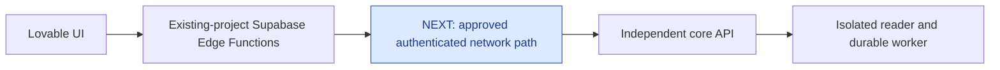

# Next: connect Supabase Edge Functions to the core

The [signed-in private reader](validation/private-tenant-reader-v1.md) now
passes provider authentication, workspace RLS, observation, navigation,
matching graph/event pages and independently confirmed native close.

The next consumer is the separate Lovable repository
`jvelezc/ai-screen-reader-ui`. Its path remains:

**Current step:** the user approved authenticated HTTPS on VPS IP
`89.117.17.81`, with DNS later. Implement and validate the
[API-only Caddy route](decisions/0053-authenticated-core-api-ingress.md), then
connect the existing project's Edge Functions. The backend and worker/broker
listeners remain private; only the selected API routes gain HTTPS reachability.
API connectivity does not publish MCP, Claude onboarding or an official plugin.

## Work for the approved HTTPS path

1. Prepare the exact host/TLS/reverse-proxy configuration for review. Preserve
   unrelated Caddy routes and keep worker/broker ports private. Verify host and
   forwarded-header checks before changing ingress.
2. Adapt Edge Functions in existing Supabase project `gpnijaxrgtwzwtrqsbcu`
   to the published core HTTP contract. Keep jobs, reader semantics and evidence
   logic in core; keep any upstream configuration server-side.
3. Preserve the original caller and tenant scope. A service-role credential
   must not substitute for the application user. Check anonymous, wrong-scope,
   expired and revoked authority; report safe failures and support references.
4. Exercise a signed-in UI -> Edge -> core fixture admission/report and reader
   lifecycle. Match actual evidence and confirm native removal. The browser
   must not fetch core directly or depend on a frontend proxy.
5. Record network reachability, Edge deployment, original-user authorization
   and visible UI acceptance separately. A healthy HTTP listener is insufficient.

**Finished means:** a real signed-in consumer completes these flows through the
existing project's Edge Functions, with denied authority and unavailable/corrupt
evidence remaining explicit. Broader hosted recovery, human/AT acceptance,
durable live-graph archival and public publication retain their own gates.
