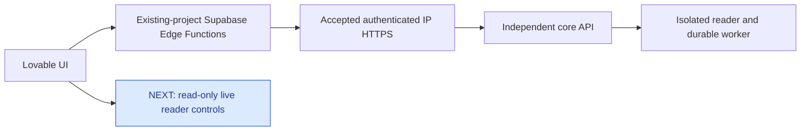

# Next: live reader controls in the notebook

The [signed-in private reader](validation/private-tenant-reader-v1.md) now
passes provider authentication, workspace RLS, observation, navigation,
matching graph/event pages and independently confirmed native close.

The next consumer is the separate Lovable repository
`jvelezc/ai-screen-reader-ui`. Its path remains:

**Current step:** API IP HTTPS and the original-user notebook -> Edge v1 -> core
fixture/report workflow are accepted. The actual user flow at UI1331a75/core2485c53
returned observed/Available/S3,32 nodes,input0,goalfalse, matching actual JSON
download and sign-out clearing. UI53533d4 passes132/132 on each OS; corebeea0b9
passes2,005/2,005 per OS and exact deployment40243214756. The private notebook
is available at http://localhost:6087/. **Next implement read-only live reader
session controls through the same original-user gateway.** Keep tenant scope,
document fencing, event/graph provenance, bounds and native-cleanup uncertainty.
The backend and worker/broker listeners remain private; only the selected API routes gain HTTPS reachability.
API connectivity does not publish MCP, Claude onboarding or an official plugin.

## Accepted and remaining work

1. **Accepted:** exact host/TLS/reverse-proxy configuration preserves unrelated
   Caddy bytes and private worker/broker ports. Core source2485c53 passed all nine
   CI jobs, Windows/Ubuntu2,004 each, native Linux30 and operator144, with exact
   deployment40236829195 and external TLS/negative-path proof.
2. **Deployed:** the thin `hsr-core` gateway in Supabase project
   `gpnijaxrgtwzwtrqsbcu` validates the original user through Auth and forwards the
   same JWT to fixed core routes. Its13 closed operations have45 synthetic unit
   cases; the complete UI suite has130. No privileged-key substitution, database
   logic or direct browser-to-core fetch is involved. Source readback matches.
3. Preserve the original caller and tenant scope. A service-role credential
   must not substitute for the application user. Check anonymous, wrong-scope,
   expired and revoked authority; report safe failures and support references.
4. **Accepted:** real signed-in UI -> Edge -> core fixture admission/report,
   matched evidence/storage/input/goal fields and an actual freshly authorized
   download. Sign-out clearing and320px reflow passed. **NEXT:** add live reader
   lifecycle controls through the existing session contract. Open one reader,
   observe a fresh document, navigate the virtual cursor, inspect paged actual
   event/state/edge evidence and explicitly close. The core's real HTTP
   reader/native-close proof remains separately tied to1a5c6dc. The browser must
   not fetch core directly or depend on a frontend proxy.
5. Record network reachability, Edge deployment, original-user authorization
   and visible UI acceptance separately. A healthy HTTP listener is insufficient.

**Finished means:** a real signed-in consumer completes the live reader lifecycle
through existing-project Edge Functions. Stale/wrong-scope/expired authority must
deny safely, graph pages must retain actual links/truncation, and lost opens or
closes must remain unconfirmed until verified. An API close acknowledgement is
separate from independent native removal. No target typing, credential entry or
verified-objective claim is introduced. Broader hosted recovery, human/AT,
durable live-graph archival, email callbacks and public publication keep their gates.

The exact-origin browser allowlist currently permits only local port6087. A
published Lovable origin and email callback configuration require independent
verification. See the consumer's
[gateway acceptance matrix and real tenant receipt](https://github.com/jvelezc/ai-screen-reader-ui/blob/53533d4247e7e385f923b337ac4d6ef61e8d338d/docs/gateway-acceptance.md).
