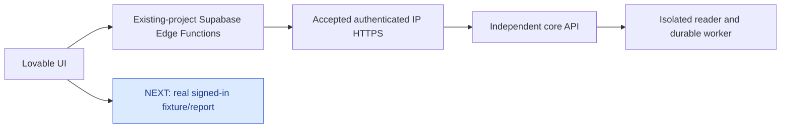

# Next: verify the signed-in Reader Notebook

The [signed-in private reader](validation/private-tenant-reader-v1.md) now
passes provider authentication, workspace RLS, observation, navigation,
matching graph/event pages and independently confirmed native close.

The next consumer is the separate Lovable repository
`jvelezc/ai-screen-reader-ui`. Its path remains:

**Current step:** the API-only Caddy route is accepted at
`https://89.117.17.81`, with publicly trusted IP TLS; DNS can follow later.
The separate notebook source1331a75 passes Windows/Linux UI CI40240113719,
130/130 each. `hsr-core` v1 is deployed in the original Supabase project, and
live negative authorization/CORS checks pass. **Sign in to the notebook at
http://localhost:6087/ with a confirmed application account; then verify an
actual workspace, fixture admission, saved evidence and fresh report download.**
Credentials stay in the form, out of chat and logs. This sign-in is separate
from the old portal at6086, Supabase dashboard and CLI administration.
The backend and worker/broker listeners remain private; only the selected API routes gain HTTPS reachability.
API connectivity does not publish MCP, Claude onboarding or an official plugin.

## Accepted and remaining work

1. **Accepted:** exact host/TLS/reverse-proxy configuration preserves unrelated
   Caddy bytes and private worker/broker ports. Core source2485c53 passed all nine
   CI jobs, Windows/Ubuntu2,004 each, native Linux30 and operator144, with exact
   deployment40236829195 and external TLS/negative-path proof.
2. **Deployed:** the thin `hsr-core` gateway in Supabase project
   `gpnijaxrgtwzwtrqsbcu` validates the original user through Auth and forwards the
   same JWT to fixed core routes. Its13 closed operations have45 synthetic unit
   cases; the complete UI suite has130. No privileged-key substitution, database
   logic or direct browser-to-core fetch is involved. Source readback matches.
3. Preserve the original caller and tenant scope. A service-role credential
   must not substitute for the application user. Check anonymous, wrong-scope,
   expired and revoked authority; report safe failures and support references.
4. **NEXT:** exercise a signed-in UI -> Edge -> core fixture admission/report.
   Match actual evidence/storage/input/goal fields and fresh download authority.
   The visible UI now supports account/workspace/runs/reports; live reader
   lifecycle controls are the following UI increment. The core's real HTTP
   reader/native-close proof remains separately tied to1a5c6dc. The browser must
   not fetch core directly or depend on a frontend proxy.
5. Record network reachability, Edge deployment, original-user authorization
   and visible UI acceptance separately. A healthy HTTP listener is insufficient.

**Finished means:** a real signed-in consumer completes these flows through the
existing project's Edge Functions, with denied authority and unavailable/corrupt
evidence remaining explicit. Broader hosted recovery, human/AT acceptance,
durable live-graph archival and public publication retain their own gates.

The exact-origin browser allowlist currently permits only local port6087. A
published Lovable origin and email callback configuration require independent
verification. See the consumer's
[gateway acceptance matrix](https://github.com/jvelezc/ai-screen-reader-ui/blob/1331a754cd5e99e2fa91f1b472e0f783b636758d/docs/gateway-acceptance.md).
