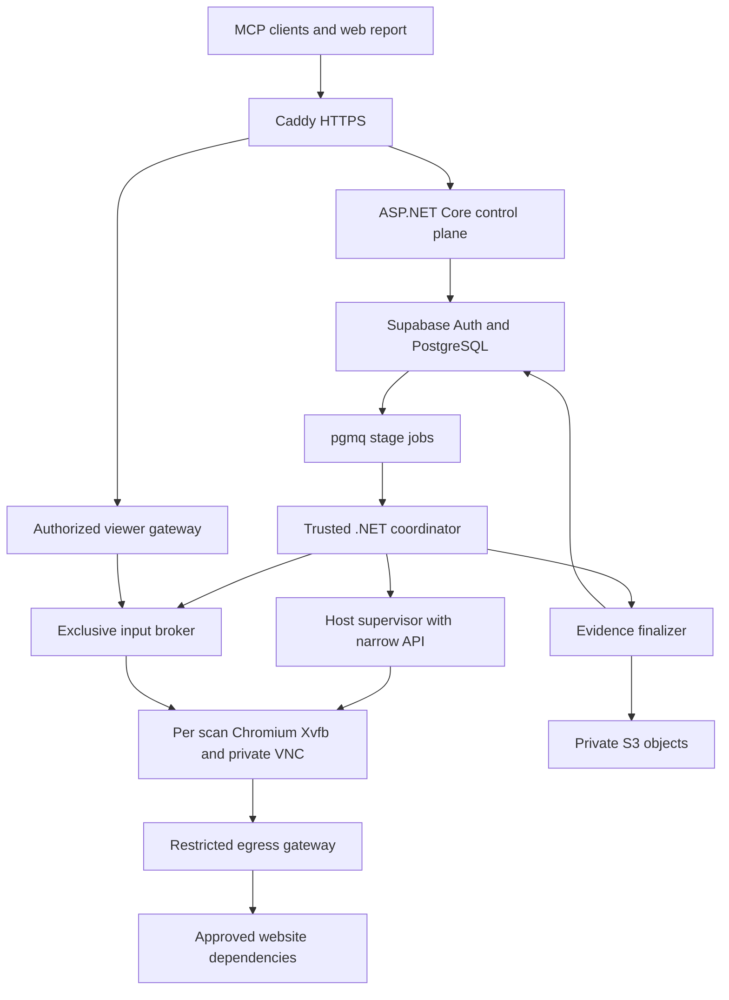

# HeadlessScreenReader Architecture Review and Development Plan

**Status:** Refined proposal for implementation planning  
**Review date:** October 17, 2026  
**Scope:** Architecture review and revised development plan. Milestones below define future acceptance tests; they do not report completed implementation.

Keep the .NET, Playwright, Chromium, Supabase, pgmq, S3, Podman, and Caddy direction. The strongest product decision is to make observed navigation and evidence the basis of every report. The design needs firmer contracts for screen-reader behavior, verified transitions, credential capture, and recovery before implementation begins.

Start with a local reference implementation and controlled websites. Prove the screen-reader model and an evidence-backed traversal before adding hosted orchestration. Security, ownership, evidence integrity, and uncertainty belong in those first contracts, even when their initial adapters use local storage.

# Architecture review

The priority labels below describe dependencies: **Foundation** must be resolved before building the navigation engine; **Hosted gate** must pass before exposing scans to users; **Later** can follow a working pilot.

| Priority | Original area | Gap and consequence | Refinement |
| --- | --- | --- | --- |
| Foundation | Sections 3 and 11 | Keyboard shortcuts, virtual cursor movement, browser focus, and activation are combined. Sending K to Chromium does not implement next-link navigation. | Define typed reader commands, separate cursor and focus, and specify activation semantics. |
| Foundation | Sections 3 and 16 | A custom announcement engine could be interpreted as evidence of NVDA, JAWS, or VoiceOver behavior. | Version the custom navigation profile and label generated announcements. Validate selected behaviors against real assistive technology and user testing. |
| Foundation | Sections 4 and 7 | The graph is called the source of truth, but retries, state identity, and durable attempt records are underspecified. | Make immutable observations and attempts authoritative; build the graph as a versioned projection. |
| Foundation | Section 4 | Verified, Burdensome, Blocked, Unknown, and Human-assisted mix outcome, difficulty, and assistance. | Store these as separate dimensions and derive report badges. |
| Foundation | Sections 4 and 5 | Reaching a URL, an unchanged page, or a timeout does not establish goal success or a barrier. | Require explicit starting-state and destination predicates; preserve unknown and system-error results. |
| Foundation | Sections 6 and 7 | Suspending recording while preserving the same context lacks an implementation contract. | Prove segmented capture with acknowledged stop/start and suspension of all sensitive collectors. |
| Foundation | Sections 10 and 14 | Safety is described as a later policy feature, although exploration already activates controls. | Put policy checks and bounded exploration into the first runnable milestone. |
| Hosted gate | Sections 6 and 8 | Queue retries and worker crashes can produce duplicate browser input or duplicate work. | Add fenced ownership, stage idempotency, command intent records, transactional enqueue, and recovery reconciliation. |
| Hosted gate | Sections 6 and 13 | A coordinator pause does not prevent simultaneous input through VNC or a stale worker. | Put every automation and viewer input path behind one authoritative controller gate. |
| Hosted gate | Sections 10 and 13 | URL checks and rootless containers alone do not isolate hostile website traffic. | Enforce egress restrictions outside the browser and keep cloud credentials outside its container. |
| Hosted gate | Sections 8 and 9 | Supabase Auth is named, but tenant enforcement and MCP OAuth compatibility are not specified. | Design membership authorization, row isolation, worker capabilities, and resource-specific MCP tokens explicitly. |
| Hosted gate | Sections 7 and 8 | Upload completion, database references, and temporary cleanup can diverge. | Use recoverable finalization stages and verify durable evidence before cleanup. |
| Later | Sections 11 and 14 | Many plugin interfaces and advanced comparison features precede a validated core. | Keep module boundaries; defer a public plugin system and broad adapters until the pilot passes. |

These are design findings from the supplied plan. The recommendations that follow are proposed engineering choices, with external sources cited where they establish platform behavior.

# Product scope and claims

The first pilot answers a bounded question: **Under a named HeadlessScreenReader profile, what did the platform discover, attempt, reach, and fail to establish on this website?**

A successful traversal means a particular attempt satisfied its declared destination predicate. It does not establish universal usability, equivalent behavior across screen readers, or independent access through an earlier human-assisted checkpoint. W3C states that automated tooling alone cannot determine accessibility conformance. Reports therefore describe the tested interaction and its evidence. [W3C accessibility evaluation overview](https://www.w3.org/WAI/test-evaluate/)

The pilot includes one Chromium session per active scan, English announcements, a documented desktop viewport, keyboard operation of supported controls, semantic reading navigation, a bounded graph, original permitted recording segments, human takeover, and evidence retrieval through a web report and MCP.

Defer mobile adapters, full document editing, generalized table navigation, speech audio synthesis, persistent disk profiles, automatic release comparison, public plugins, and unrestricted autonomous consequential workflows. Cross-origin frame and popup coverage must be explicit: support and test them or mark the affected goal unknown. A supported frame must never disappear silently from a completeness claim.

The application should use a headed Chromium process on Xvfb when a VNC viewer is required. “Headless” describes the screen-reader engine and unattended service operation; it does not require switching Chromium launch mode during a scan. Keep the same browser process and context throughout a takeover.

# Deployment and component boundaries

Use a modular ASP.NET Core control plane and a trusted .NET worker coordinator, with a small host supervisor. Avoid creating separate deployable services for every conceptual responsibility.

The diagram shows trust and control boundaries. The input broker is the only route for CDP operations that can mutate the browser and for VNC input. Observation channels may be read-only. A VNC proxy or equivalent relay must enforce controller ownership server-side; hiding a control in the viewer is insufficient.

Recommended code modules:

| Module | Responsibility |
| --- | --- |
| Domain | Commands, observations, attempts, findings, policies, and lifecycle transitions without infrastructure dependencies. |
| ScreenReader | Reading order, virtual cursor, modes, supported activation rules, and announcement generation. |
| Browser.Chromium | Playwright and CDP adaptation, document identity, focus observations, frame coverage, and browser operations. |
| Exploration | Bounded planning from reader-visible observations and verification of postconditions. |
| Evidence | Sanitized event capture, recording segments, manifests, annotation, and finalization. |
| Server | MCP, web API, tenant authorization, sessions, job dispatch, and report queries. |
| Worker | Execution loop, controller gate, leases, checkpoints, and coordinator recovery. |
| Infrastructure | PostgreSQL, pgmq, S3, and host supervisor adapters. |
| Report | Accessible web graph, equivalent traversal table, video, and event transcript. |

Pin the supported .NET SDK, Playwright package and driver, browser build, OS image digest, FFmpeg version, and schema/profile versions together in an environment manifest. Build the same fixture suite on Windows for development and on the target Linux image for release; passing on one does not establish behavior on the other.

The browser container receives no Supabase administrative secret, database credential, S3 account credential, Podman socket, or general host mount. The trusted coordinator handles persistence. The supervisor accepts fixed operations such as create worker, stop worker, and inspect health using approved image digests and bounded resource settings; it must not accept arbitrary shell commands, mounts, or Podman arguments.

Use Quadlet for the long-lived control plane, coordinator, gateway, and supervisor dependencies. Let the supervisor manage ephemeral browser containers through a narrow host interface and reconcile orphaned containers after restart. Rootless Quadlet has specific user unit locations and startup behavior that should be exercised on the target host. [Podman Quadlet reference](https://docs.podman.io/en/latest/markdown/podman-systemd.unit.5.html)

# Screen reader behavior

## Observation and diagnostic separation

Expose two different contracts. **ReaderObservation** contains exposed accessibility semantics and observed focus or widget state. **DiagnosticObservation** may include DOM structure, test identifiers, visual inference, browser logs, or unlabeled capability hypotheses.

The planner uses ReaderObservation to decide what the simulated user can identify and do. Diagnostics may explain a result or evaluate a declared destination predicate, but must not silently supply the missing label or hidden target. Record whether a postcondition was verified through reader-visible feedback or diagnostic inspection.

For an unlabeled cart icon, retain a diagnostic feature hypothesis such as “cart control,” the exposed reader announcement “button,” and the attempts made. Do not rename the button in the reader observation. Operating an unlabeled control does not prove that its purpose was independently identifiable.

## Commands and activation

NVDA documents separate browse and focus modes and single-letter navigation within browse mode. This supports separating command interpretation from keys passed to the page; it does not supply an implementation of equivalent behavior in Chromium. [NVDA browse mode documentation](https://api.nvaccess.org/documentation/userGuide.html#BrowseMode)

Represent commands as NextHeading, NextLink, NextButton, NextLandmark, MoveNext, MovePrevious, ReadCurrent, SetMode, PressBrowserKey, ActivateCurrent, and EnterSyntheticText. Bind H, K, and B to reader commands only under the selected profile. Each execution records the reader command and every browser operation it caused.

In browse mode, NextLink moves the virtual cursor through exposed link nodes and generates an announcement. It need not change browser focus. In focus mode, keys go to the focused supported control. Tab and Shift+Tab record the browser's actual focus transition.

For the first implementation, verify activation through the element that actually has keyboard focus. If the virtual cursor points elsewhere, return FocusRequired and either perform an explicit, logged keyboard focus traversal or leave activation unsupported. Do not use a hidden locator click or injected focus to manufacture a keyboard success. Count any extra traversal separately so implementation overhead is visible.

A later accessibility-action adapter may support semantic activation at the virtual cursor after a dedicated fidelity test. Such attempts must identify their activation mechanism and must not be reported as keyboard-only paths. Direct DOM click and arbitrary script execution stay outside the navigation contract.

## Accessibility adapter

Use Playwright's CDP session to request Chromium accessibility data. The old Page.Accessibility API was removed in Playwright 1.57. [Playwright release notes](https://playwright.dev/dotnet/docs/release-notes), [Playwright .NET CDP sessions](https://playwright.dev/dotnet/docs/api/class-cdpsession)

Enable the CDP accessibility domain, collect exposed nodes and their hierarchy, and scope node identity by browser session, page, frame, and document generation. Chromium documents that enabling this domain stabilizes AX node IDs between calls; do not treat these as permanent IDs across document replacement or browser recovery. The full-tree request has a frame parameter, so frame coverage must be deliberate. [Chromium accessibility protocol](https://chromedevtools.github.io/devtools-protocol/tot/Accessibility/)

Maintain document reading order, role, accessible name and description, relevant state, relationships, and text. Do not conflate DOM order, tab order, and accessibility reading order. Track DOM focus, exposed accessibility focus, active descendant, virtual cursor, and reader mode separately. ARIA composite widgets may keep DOM focus on a container while exposing the active child through aria-activedescendant. [W3C keyboard interface guidance](https://www.w3.org/WAI/ARIA/apg/practices/keyboard-interface/)

Refresh observations after actions and relevant changes. Use a bounded settling rule that considers focus, accessibility changes, navigation, and the declared postcondition; avoid relying solely on network idle. Preserve stale-node, detached-frame, and unsupported-role results as explicit engine limitations.

Generated announcements carry engine version, profile version, source observation IDs, language, reason, and event sequence. They are simulated HeadlessScreenReader output. Live regions need a versioned rule for politeness, atomicity, busy state, interruption, and deduplication. Until those rules are validated, label live-region behavior partial rather than treating every snapshot difference as a spoken update.

# Traversal model and verification

## Authoritative records

Store immutable observations, command events, and traversal attempts. Build graph revisions and summaries from those records. Corrections append a new assessment or projection revision; they do not rewrite an earlier attempt. Privacy deletion can remove protected payloads while leaving a non-sensitive deletion marker under the retention policy.

A Feature is a capability hypothesis with provenance and confidence. A StateObservation is an observed browser and reader state. A StateCluster is a grouping used for graph display. A TraversalAttempt joins an observed source to an observed result, including failed or uncertain results. A Finding explains a specific issue and links the relevant attempts and observations.

Use typed relationships between capabilities, states, and findings. Keep diagnostic feature relationships visually distinct from executed navigation edges.

## State identity

A URL alone is insufficient. A candidate state signature includes normalized origin and route, page and frame identities, document generation, modal stack, relevant exposed tree structure, browser focus, active descendant, reader cursor and mode, viewport, locale, and an opaque authentication-context reference.

Exclude passwords, tokens, and sensitive field values from signatures. Save observations separately from clustering logic so overly broad or overly narrow grouping can be corrected. Any normalization of volatile content must be versioned and explainable. A fingerprint is a matching aid, not proof that replay is safe.

Authentication storage is a restoration aid, not a running browser checkpoint. Playwright supports saving selected authenticated state and warns that these files may enable account impersonation. Application state and restoration completeness require their own checks. [Playwright authentication documentation](https://playwright.dev/dotnet/docs/auth)

## Independent result dimensions

| Dimension | Proposed values | Interpretation |
| --- | --- | --- |
| Execution | Completed, Interrupted, Cancelled, SystemError | Whether the test itself ran to a usable observation. |
| Reachability | Reached, NotReached, Unknown | Whether the specified destination predicate was satisfied. |
| Barrier | Observed, Suspected, NoneObserved, NotAssessed | Whether an obstacle was established and how strongly. |
| Burden | Low, Medium, High, NotAssessed | Explainable interaction effort under the selected profile. |
| Assistance | None, HumanEarlierInPath, HumanDuringAttempt | Where intervention occurred. |
| Policy | Allowed, Denied, ApprovalRequired | Whether input was permitted. |
| Evidence | Pending, Complete, Partial, Unavailable, Deleted | Availability of supporting artifacts. |

Path assistance is cumulative: an independent final attempt does not erase human assistance earlier in the path. Reports may separately describe an independently tested subworkflow after an assisted setup.

A Verified badge requires a satisfied postcondition and supporting observation references; evidence availability appears alongside it. Burdensome means reached with an assessed high burden. Blocked requires an observed barrier for the tested route. A policy denial is PolicyRestricted, and a browser crash is SystemError. Neither should appear as a website accessibility failure.

Every attempt records its precondition, intended destination, observed result, command sequence, controller epoch, timestamps, verification rule and version, outcome dimensions, and evidence references. When nothing changes, record the unchanged observation and NoObservedProgress. A bounded timeout may produce Unknown; only an established obstacle warrants Blocked.

For example, a link activation aimed at checkout can end at a validation dialog. The attempt points to that dialog and retains checkout as the intended destination. It must not create a successful edge to checkout.

## Exploration and scoring

Begin with deterministic bounded exploration using reader-visible roles, names, order, and known widget patterns. Bound depth, distinct states, actions per state, no-progress repetitions, elapsed time, pages, and recording bytes. Keep a visited frontier keyed by state cluster, command, and profile. Infinite scrolling and continuously changing content must terminate with a coverage reason.

Support targeted goals with explicit postconditions, such as an exposed Checkout heading plus an expected shipping form. Free-text goals may require clarification or mapping to a supported goal template; an arbitrary goal string must not become a guessed success predicate.

Report tested alternatives, untested frontier, exclusions, and stop reason. Do not publish a percentage of the entire website unless a defensible inventory denominator exists.

Keep raw metrics before deriving burden: reader commands, actual browser keystrokes, repeated paths, ambiguous announcements, focus disruptions, recovery attempts, active exploration time, and wait time. Human pause time is separate. Version thresholds and explain which factors triggered a high score; long paths alone do not establish inaccessibility.

# Sessions and exclusive control

Model scan execution, browser lifecycle, controller ownership, and evidence finalization separately. A scan can finish exploration while its evidence is still uploading.

Use execution states Created, Queued, Starting, Exploring, AwaitingUser, PausedByUser, Finalizing, Completed, Failed, Cancelled, and Expired. Human ownership belongs to a control lease rather than an extra execution state. Completion includes a coverage summary and stop reason, so a completed bounded scan can contain unknown goals.

Every browser mutation carries a scan ID, session ID, command ID, expected document generation, controller type, and monotonically increasing control epoch. The authoritative input broker rejects expired or superseded epochs and duplicate command IDs. All VNC keyboard, pointer, clipboard, upload, and browser-level controls must pass the same gate or be disabled.

Takeover sequence:

1. Stop dispatching automation and wait for the current command to finish or report interruption.
2. Fence the old automation epoch and drain pending inputs.
3. Stop sensitive recording and collectors, await acknowledgement, and mark the evidence gap.
4. Issue a short-lived user control lease bound to the authenticated user and exact session.
5. On Resume, revoke the human epoch, close input forwarding, and confirm no in-flight user input remains.
6. Confirm that the current page is permitted for capture under the privacy policy. If that cannot be established, keep capture suspended and report the required next action.
7. Start a new recording segment when permitted, refresh browser and reader observations, and append the human-assisted transition.
8. Validate the new state and grant a new automation epoch.

The broker closes input on lease expiry, loss of trusted coordinator connectivity, or uncertain ownership. Browser workers need a local watchdog; database lease expiry alone cannot stop a disconnected process with an open input channel.

Viewer URLs must not become permanent bearer links. Authenticate the viewer and authorize each connection; bind any bootstrap token to a short lifetime and single exchange, and support revocation. Do not expose raw CDP, VNC, or Playwright connection endpoints to MCP clients.

For assistive access, a pixel viewer alone is insufficient. Provide an accessible pause/resume interface and semantic observation view. Whether blind users can independently operate authentication through the selected remote viewer is an explicit pilot test; if unsupported, describe the intervention requirement accurately.

# Evidence capture and privacy

## Capture contract

Use segmented recordings with a manifest. Original means the unedited bytes of each permitted capture segment. There is no continuous original covering excluded credential entry. Annotated video is a derivative referencing those segments and the event timeline.

Playwright's context video recording is finalized when the context closes. Its newer Screencast API supports explicit start and stop without specifying context recreation. Prefer a pinned, tested Screencast implementation for this requirement, subject to a stop/start privacy test against the exact browser build. Do not assume that the older RecordVideoDir setting can be paused. [Playwright .NET videos](https://playwright.dev/dotnet/docs/videos), [Playwright .NET Screencast API](https://playwright.dev/dotnet/docs/api/class-screencast)

Before granting credential entry, suspend video writing, screenshots, trace snapshots, HAR capture, accessibility payload storage, clipboard capture, form values, and typed-key logging. Keep only sanitized lifecycle events. Already queued frames must be flushed or excluded before input is enabled.

Passwords are only one sensitive source. OTPs, reset links, account details, addresses, messages, and tokens may appear in page content, URLs, console output, or network bodies. Default to no persisted input values or network bodies. Use synthetic data for automated form tests. If an arbitrary page cannot meet the agreed capture policy, pause capture or exclude it; masking password fields alone is not a privacy guarantee.

## Timeline and manifest

Use a per-session monotonic clock and event sequence; also record UTC for correlation. Each event references command, attempt, page, frame, document, controller epoch, and recording segment where applicable.

Map recording presentation timestamps to the event clock with an explicit offset and measured uncertainty. Capture browser frame timestamps when supported by the pinned build, and validate the mapping rather than assuming recording starts at browser launch. Represent excluded intervals as gaps; do not interpolate actions across them.

A manifest contains scan and attempt references, segment IDs, event ranges, video time ranges, dimensions, environment versions, SHA-256 hashes, derivative version, capture gaps, and finalization status. Preserve the engine's pre-action observation, input dispatch, post-action observation, focus changes, and announcements as separate events.

## Durable finalization

Finalize through recoverable stages: close segment, validate decodability, sanitize, hash, upload original segments, verify stored integrity and size, commit their manifest references, generate derivatives, verify derivatives, commit a finalization receipt, and clean local staging.

Use immutable object names scoped by organization, scan, attempt, segment, and artifact version. Repeated uploads must either match the recorded content identity or create a new version. S3 supports checksum verification; record an explicit content hash rather than treating an ETag as the evidence hash. [Amazon S3 integrity checks](https://docs.aws.amazon.com/AmazonS3/latest/userguide/checking-object-integrity.html)

Persist the finalization receipt before acknowledging its queue job or deleting staging files. An annotation failure can leave original evidence available with DerivativeFailed; it should not invalidate an observed traversal. Storage failure leaves evidence pending or unavailable and must be visible in the report.

Keep S3 private and encrypt objects and temporary staging under defined keys. Authorize every playback grant. Presigned URLs are bearer credentials and can be reused until expiry, so use short lifetimes and an authenticated gateway when immediate per-user revocation is required. [Amazon S3 presigned URL behavior](https://docs.aws.amazon.com/AmazonS3/latest/userguide/using-presigned-url.html)

Set concrete retention values before a hosted pilot for staging, recordings, events, authentication snapshots, and backups. Deletion must cover derivatives, object versions where applicable, expired multipart uploads, and profile encryption keys. A hash proves byte integrity against its reference; it does not independently prove that an accessibility assessment is correct.

# Persistence and job recovery

Retain PostgreSQL and pgmq. Add organization memberships and explicit policy/profile versions. The logical records are:

| Group | Records and constraints |
| --- | --- |
| Ownership | organizations, organization_memberships, projects, websites; tenant ownership derived from authenticated membership. |
| Execution | scans, browser_sessions, worker_leases, control_leases, command_intents; compare-and-swap lifecycle and fencing epochs. |
| Observation | state_observations, reader_events, diagnostic_observations, features; provenance and capture policy references. |
| Traversal | traversal_attempts, findings, graph_revisions, graph_nodes, graph_edges; graph references authoritative observations. |
| Evidence | evidence_manifests, recording_segments, evidence_artifacts, finalization_receipts; immutable content identity. |
| Recovery | stage_jobs, scan_checkpoints, audit_events; idempotency keys, retry counts, and safe failure details. |

Enforce same-tenant relationships with composite foreign keys or equivalent database checks, not just independently valid IDs. Index tenant, scan, event sequence, status, and stage deduplication keys.

Create the scan and enqueue its first pgmq job in one database transaction through a controlled database function. If that is impossible through the selected API path, use a transactional outbox and dispatcher. Apply the same rule when a completed stage creates its successor.

Pgmq hides a read message for its visibility timeout and can expose it again if it is not removed in time. It supports extending visibility. Therefore, business execution must tolerate redelivery even though the queue prevents competing reads within a visibility interval. [pgmq queue semantics](https://github.com/pgmq/pgmq), [pgmq visibility functions](https://pgmq.github.io/pgmq/api/sql/functions/)

Claim each stage with a unique key such as organization, scan, stage, and generation; allocate a worker fencing epoch. Renew queue visibility and application ownership independently. A queue message is a dispatch signal, not proof of exclusive ownership.

Persist an action intent before dispatch and append the observed result afterward. If the worker dies between those steps, mark UncertainExecution. Reobserve the browser or restart from an eligible safe checkpoint. Do not automatically repeat submission, purchase, deletion, or another potentially consequential activation. A browser side effect cannot be made atomic with a PostgreSQL commit.

During AwaitingUser, persist the pause checkpoint and retain a renewable browser lease until the session deadline. Acknowledge the completed dispatch stage after that checkpoint is durable; resume creates a new stage. Do not depend on holding a queue message invisible throughout an unpredictable login wait.

A reconciler detects stale leases, unclosed segments, unacknowledged completed jobs, orphaned workers, and pending uploads. Use bounded retries with backoff and an explicit terminal failure or dead-letter record. Preserve completed attempts and any recoverable evidence.

Checkpoints store graph frontier, durable event position, current profile/policy, current safe state references, and permitted encrypted auth state. Recovery may require a new browser and a verified setup path. Browser storage does not resurrect JavaScript memory, open dialogs, remote transactions, or a lost human interaction.

# Security and policy enforcement

## Network and runtime isolation

Treat website content as hostile input. Allow approved target origins and explicitly approved dependencies. Separate main-navigation permission from resource-fetch permission so a CDN does not become a navigable target.

Validate schemes, ports, redirects, A and AAAA resolution, IPv4-mapped IPv6, loopback, private and link-local ranges, cloud metadata, and host/container service addresses. Enforce these restrictions at the actual connection boundary through an egress gateway and host network policy. Prevent DNS rebinding and direct-egress bypass. Apply them to frames, popups, workers, WebSockets, and human navigation as well as automation.

Playwright routing is useful for policy visibility but is not the security boundary; its documentation describes service-worker traffic that can evade route interception. Any decision to block service workers changes the test environment and belongs in the report. [Playwright network interception limitations](https://playwright.dev/dotnet/docs/network)

Use a non-root browser user, tested Chromium sandbox, restricted seccomp, dropped capabilities, read-only image, dedicated writable staging, and CPU, memory, process, shared-memory, disk, and lifetime limits. Fail worker admission when the required sandbox is unavailable. Do not silently fall back to --no-sandbox or privileged mode. Playwright's container guide describes sandbox requirements and cautions against treating its default testing image as a deployment for untrusted sites. Podman compatibility must be proven on the selected host. [Playwright .NET container guidance](https://playwright.dev/dotnet/docs/docker)

A single-host Podman pilot has a shared-kernel failure boundary. Wider exposure to arbitrary hostile sites may require a separate browser host or stronger isolation. Keep the browser interface independent so that deployment can change without rewriting reader semantics.

## Interaction decisions

Policy evaluation occurs before every mutation, including Enter, Space, text entry, semantic activation, uploads, and human actions covered by platform restrictions. A control label or HTTP method is not a reliable description of side effects.

For owned test fixtures and test accounts, use an approved action catalog and synthetic data. For arbitrary sites, allow explicitly scoped navigation and known reversible interactions; ambiguous or consequential actions return ApprovalRequired or Denied. Describe this as a bounded exploration policy, because arbitrary websites can attach side effects even to apparent navigation.

An approval records actor, exact operation, target context, expected state, policy version, expiry, and use limit. Changed context invalidates it. Retrying or live replay reevaluates policy; historical success never grants new authorization.

Treat website text and diagnostic strings as untrusted data when returned to AI clients. They cannot change platform permissions or instruct the planner to reveal secrets. Free-text goals are requests, not executable scripts.

## Tenant and credential boundaries

Authorize the user and membership for every scan, status query, graph, evidence grant, viewer connection, resume, and deletion. Never trust an organization ID supplied by a client as proof of membership.

Enable RLS on exposed tenant tables and test both reads and writes across two organizations. Give workers narrow database functions or scoped capabilities. Administrative server access may bypass RLS, so its application authorization and database constraints remain necessary. Supabase documents that administrative secret access can use the service_role role with bypass privileges. [Supabase RLS guidance](https://supabase.com/docs/guides/database/postgres/row-level-security)

Keep reusable authentication snapshots opt-in, encrypted under revocable keys, and scoped to user, tenant, website, and allowed identity-provider origins. The default pilot should discard authentication state when the session ends. Persistent Chromium profiles need a separate threat and deletion review before adoption.

# MCP and report contracts

Use the official C# MCP SDK with its ASP.NET Core integration, pinned to tested package versions. Define a compatibility matrix for the server, SDK, and actual client builds. [Official MCP C# SDK](https://github.com/modelcontextprotocol/csharp-sdk)

Use Streamable HTTP for hosted access. The current July 28, 2026 revision changed transport behavior, including protocol-level sessions; application browser sessions must remain independent of those transport details. Support older client protocol versions only through explicit compatibility tests. [MCP Streamable HTTP specification](https://modelcontextprotocol.io/specification/2026-07-28/basic/transports/streamable-http)

The MCP server is an OAuth resource server. Implement protected-resource discovery and validate token issuer, audience, expiry, and scopes. Retain Supabase for application identity, but prove that the chosen authorization-server setup issues tokens intended for the MCP resource; a generic Supabase JWT is not automatically sufficient. Keep downstream service credentials separate. [MCP authorization](https://modelcontextprotocol.io/specification/2026-07-28/basic/authorization), [MCP security guidance](https://modelcontextprotocol.io/docs/2026-07-28/tutorials/security/security_best_practices)

Keep start_scan short-lived: validate scope, durably create or retrieve the idempotent scan, and return its ID and status/report references. A client disconnect must not be the application's only cancellation mechanism.

| Tool group | Pilot contract |
| --- | --- |
| start_scan | Validated URL, supported goal, policy/profile selection within caller permissions, bounds, and idempotency key. |
| get_scan_status | Execution state, evidence state, stage, counters, last durable progress, stop reason, and safe next action. |
| get_features and get_barriers | Paginated diagnostic provenance, tested coverage, findings, and uncertainty. |
| get_graph and get_traversals | Revision, bounded result page, observed attempts, assistance, verification, and evidence references. |
| get_evidence | Authorized metadata and short-lived playback access for exact artifacts. |
| pause_scan, cancel_scan, resume_scan | Explicit lifecycle changes with expected state/version and caller authorization. |
| request_human_control and release_human_control | Viewer handoff through application control leases. |
| replay_traversal | Precondition check, new attempt ID, fresh policy decision, bounded execution, and no historical overwrite. |
| test_feature | New targeted work under a declared goal and existing scan/session rules. |
| compare_scans | Later milestone; requires comparable profiles, environments, preconditions, and coverage. |

Paginate graph data and event ranges; return an overview before large artifacts. Use stable schema versions and structured errors with stage, safe code, retryability, support reference, and next action. Raw browser payloads, credentials, and signed playback URLs do not belong in general logs.

Use Realtime for coarse progress notifications. The durable event cursor remains authoritative, and clients resynchronize after reconnect. Supabase notes per-subscriber authorization overhead for Postgres Changes, so avoid broadcasting full accessibility trees or every keystroke through it. [Supabase Realtime scaling guidance](https://supabase.com/docs/guides/realtime/postgres-changes)

The report UI should provide an accessible traversal list or table equivalent to the graph. Keyboard users must be able to select attempts, read annotations, inspect transcripts, and control playback. Distinguish recorded playback from live execution with separate controls. Replay checks the source state, uses a verified setup path when permitted, and creates a new attempt; it never silently restores an approximate state or repeats a consequential action.

# Development milestones and acceptance gates

Sequence milestones by risk. These gates replace broad phase completion claims with observable outcomes. Estimates should follow the feasibility milestone; the source plan does not establish team capacity or measured browser cost.

## Milestone 0 validates the core assumptions

Build only small experiments for the decisions most likely to change the architecture: normalized CDP observations, independent cursor/focus, browse versus focus routing, supported activation, headed Xvfb takeover, recording stop/start, and a minimal authenticated MCP handshake.

Accept when controlled fixtures demonstrate that a reader shortcut is not sent to the page in browse mode, browser keys reach the focused control in focus mode, ambiguous activation stays explicit, and the chosen package/browser combination supports the proposed adapter.

The credential experiment uses synthetic canary values and proves their absence from persisted video frames, screenshots, events, snapshots, traces, network bodies, staging, and logs during takeover. Prove the same browser context survives, and that recording gaps are represented.

Document one supported navigation profile and its limitations. Compare selected role, focus, and announcement cases with real NVDA behavior as reference validation; differing behavior must be explained rather than hidden. Separately record the MCP protocol and client versions actually exercised.

**Deliverable:** feasibility report, fixture results, pinned environment manifest, and resolved architecture decisions. Stop at this gate if activation, privacy, or isolation requires redesign.

## Milestone 1 delivers the local screen reader foundation

Build the reusable .NET library, Playwright/CDP adapter, local command runner, versioned event schema, local artifact storage, bounded execution, and policy checks. Local fixtures may use a narrowly configured loopback exception; that test setting must not carry into hosted target policy.

Use fixtures for headings, landmarks, named and unnamed controls, disabled states, text entry, checkbox state, focus order, modal entry and return, active descendants, dynamic alerts, stale nodes, and unsupported frames.

Accept when commands produce repeatable observations and simulated announcements under a pinned environment; unsupported cases remain explicit; and a keyboard path reaches a declared fixture postcondition with its command and focus history intact. This is a local engine gate, with no implication of hosted readiness.

**Deliverable:** library, CLI demonstration, documented profile, and local test results.

## Milestone 2 delivers one complete evidence backed workflow

Add feature diagnostics, immutable attempts, graph projection, bounded alternate routes, burden metrics, recording segments, and local replay/report viewing.

Use a controlled commerce fixture with a successful route and an intentionally blocked route. Stop before real payment. A diagnostic cart label must not repair an unnamed reader control.

Accept when every displayed traversal links to source and result observations, a declared verification result, and available evidence. Clicking an attempt selects the correct recording segment and timeline range. Selecting recorded evidence produces no input in the live browser.

Test matching source states with changed DOM instances and different states sharing the same URL. Across at least 20 fixture action markers, proposed synchronization acceptance is no more than 250 ms absolute error; preserve measured uncertainty and revise this target explicitly if the capture pipeline cannot support it.

**Deliverable:** local graph report for the fixture, original segments, transcript, and reproducible test instructions.

## Milestone 3 proves safe intervention and host isolation

Deploy the browser and viewer on the target Linux/Podman environment. Add the authoritative input broker, host watchdog, egress restrictions, session expiry, private VNC gateway, and synthetic credential handoff.

Accept when simultaneous automation and human commands cannot both execute, stale epochs are rejected at the input boundary, viewer revocation works, and takeover preserves the same browser context. No canary credential appears in the captured artifacts.

Test private-address access, redirect chains, IPv6, rebinding, frames, service workers, WebSockets, popups, and bypass attempts from human control. Confirm browser-container access to database credentials, cloud metadata, Podman socket, and host services is blocked.

**Deliverable:** hosted intervention and isolation evidence, with supported remote-viewer accessibility behavior documented.

## Milestone 4 proves durable hosted execution

Add Supabase schema and authorization, pgmq stages, fenced leases, checkpoints, private S3 finalization, cleanup, and reconciliation.

Inject duplicate messages, coordinator crash after input, crash after upload but before metadata commit, lease expiry, storage outage, annotation failure, and user wait expiry. Accept when durable attempts survive, pending work is visible, uncertain actions are not blindly replayed, completed stages deduplicate, and staging is retained until persistence is verified or reported unrecoverable.

Cross-tenant tests cover metadata, graph, playback, realtime, viewer, resume, deletion, and foreign-key mismatches.

**Deliverable:** recovery test report, two-tenant authorization tests, operational runbook, and evidence persistence receipt.

## Milestone 5 delivers the hosted MCP pilot

Expose supported MCP tools and the accessible report through HTTPS. Add quotas, audit events, rate limits, observability, explicit cancellation, and end-to-end operational diagnostics.

Accept when each named target client can authenticate, start a bounded scan, recover status after disconnect, open the report, perform an authorized intervention, inspect evidence, and request an eligible live replay. Record acceptance separately for every client and protocol version tested.

Exercise backup restoration, revocation, retention deletion, full staging disk, browser timeout, and server restart. Each failure must have a visible state and safe next action.

**Deliverable:** a bounded hosted pilot with traceable acceptance evidence. Broader screen-reader claims require additional real assistive-technology and user validation.

## Milestone 6 extends measured capability

Add regression comparisons, more controls, validated semantic activation, custom profiles, configurable scoring, and storage/browser extensions as separate increments. Compare scans only when profile, environment, initial state, fixture data, and relevant goal coverage are compatible. Report incompatibility rather than a misleading regression score.

A public plugin API follows proven extension needs. Authorization, command attribution, privacy, and evidence contracts remain mandatory for every extension.

# Operating limits and unresolved decisions

Start with one active browser and one separately bounded finalizer on the pilot server. This is a conservative starting configuration, not a demonstrated capacity. Measure browser and FFmpeg memory, CPU, recording growth, upload time, and API responsiveness before increasing concurrency.

Proposed initial scan bounds are 10 minutes of active exploration, 100 states, 500 reader commands, depth 10, two pages, and a 5-minute human wait, with tenant-configurable lower limits. Set recording and staging byte limits after the feasibility measurements. The server stops admissions before disk exhaustion and reports any quota-limited coverage.

Track queue age, last durable progress, heartbeat age, action failures, controller conflicts, browser exits, evidence backlog, disk pressure, denied egress, and tenant rate limits. Health checks should distinguish API readiness, scheduler progress, available browser capacity, and evidence persistence.

Resolve these decisions at their owning gate:

| Decision | Recommended starting position | Resolution gate |
| --- | --- | --- |
| Custom reader fidelity | One explicit HeadlessScreenReader profile; keyboard-focused activation first. | Milestone 0 |
| Capture implementation | Tested segmented Screencast capture; no sensitive collectors during takeover. | Milestone 0 |
| MCP compatibility | Pin SDK and supported protocol/client matrix; demonstrate actual auth flow. | Milestone 0, revalidated at 5 |
| Browser isolation | Separate untrusted browser container, required sandbox, external egress control. | Milestone 3 |
| Remote authentication accessibility | Test selected viewer with keyboard and assistive access; document unsupported cases. | Milestone 3 |
| Auth-state reuse | Off by default; encrypted opt-in snapshots before persistent profiles. | Milestone 3 |
| Pilot traffic scope | Owned fixtures and specifically approved sites/test accounts before wider scanning. | Milestone 3 |
| Evidence retention | Concrete durations and deletion ownership, including backups and object versions. | Milestone 4 |
| Completion on derivative failure | Preserve original evidence and show a separate derivative failure. | Milestone 4 |
| Deployment recovery objectives | Define backup recovery time and acceptable data-loss window; test restoration. | Milestone 5 |
| Server sizing and concurrency | Measure one browser and one finalizer before raising limits. | Milestones 3 to 5 |

Maintain architecture decision records for these choices, with the tested versions, evidence, and conditions that would trigger reconsideration.

# MVP completion criteria

The MVP is accepted when an authorized pilot user can start a bounded website goal through a tested MCP client, observe a persistent browser session, intervene under exclusive control, resume, inspect an accessible graph or equivalent traversal table, play the corresponding original evidence, and request a policy-eligible live replay that creates a separate result.

Acceptance also requires correct handling of blocked, burdensome, unknown, assisted, policy-restricted, and system-error cases; verified tenant isolation; credential exclusion; durable evidence; bounded recovery; and visible operational failures.

Publish a release receipt containing the engine/profile versions, browser and container digests, supported controls and frames, tested clients/protocols, security and recovery results, known limitations, and evidence of each hosted workflow. Local tests, hosted deployment, real assistive-technology comparison, and customer acceptance remain separate gates.

The first implementation should proceed through Milestone 0 and Milestone 1, then be evaluated against their acceptance evidence before committing to broader platform scope.

